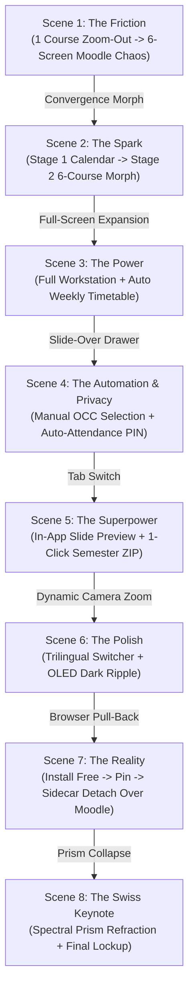
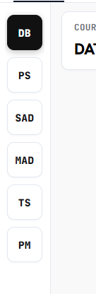

# SPeCTRUM PRO™ — Master Promotional Video Production Specification

> **Project**: SPeCTRUM PRO™
> **Target Audience**: Universiti Malaya (UM) Undergraduates & Postgraduates
> **Brand Tagline**: *The Academic Workstation. Built for UM Students.*
> **Visual Aesthetic**: Swiss Modernist / High-Contrast Monochrome / Apple & Linear Keynote Style
> **Core Trust Pillars**: `[ NO PASSWORDS NEEDED ]` · `[ 100% LOCAL BROWSER ENGINE ]` · `[ TRILINGUAL EN · BM · 中 ]`
> **Target Duration**: ~50–60 Seconds (Full Cut) / Modular for 15–30s Shorts

---

## Table of Contents

1. [Narrative Architecture &amp; Flowchart](#1-narrative-architecture--flowchart)
2. [Strict Anti-AI-Slop Visual Rules](#2-strict-anti-ai-slop-visual-rules)
3. [Scene-by-Scene Cinematic Choreography (Scenes 1–8)](#3-scene-by-scene-cinematic-choreography)
4. [Master Voiceover (VO) &amp; On-Screen Text (OST) Deck](#4-master-voiceover-vo--on-screen-text-ost-deck)
5. [The 6 Stitch Generation Prompts (Project: 16660590165662968010)](#5-the-6-stitch-generation-prompts)
6. [Interactive HTML Stages &amp; Recording Setup Guide](#6-interactive-html-stages--recording-setup-guide)
7. [Sound Design &amp; Audio Cues](#7-sound-design--audio-cues)

---

## 1. Narrative Architecture & Flowchart

The video follows an 8-chapter progression designed for maximum student empathy, dramatic problem amplification, instantaneous solution delivery, deep feature demonstration, security demystification, and a memorable keynote close.




---

## 2. Strict Anti-AI-Slop Visual Rules

To maintain an authentic, high-end engineering feel and avoid generic "AI marketing video" tropes:

1. **Zero Icons and Zero Emojis in Typographic Overlays**:
   - Never use smiley faces, thumbs up, cartoon vectors, or 3D floating emojis.
   - Hierarchy and impact must be driven strictly through **typographic scale, font weight, and high contrast**.
2. **Typography System**:
   - **Headlines & Key Statements**: `Hanken Grotesk` (Weight: 900 Black or 800 Bold, tracking: `-0.04em`).
   - **Technical Tags, Codes, Status Badges & Timestamps**: `JetBrains Mono` (Weight: 700 Bold, uppercase).
3. **Monochrome Dominance (90/10 Rule)**:
   - 90% of the visual space is pure obsidian black (`#09090B`), stark white (`#FAFAFA` / `#FFFFFF`), and subtle hairline borders (`#27272A` / `#E4E4E7`).
   - 10% strictly reserved for semantic functional status:
     - **Blue (`#2563EB`)**: Announcements & Notices
     - **Orange (`#F97316`)**: Assignments & Deadlines
     - **Emerald Green (`#10B981`)**: Attendance & Active Check-in
4. **Universal Scrollbar Suppression**:
   - All browser, stage, and stream containers have scrollbars hidden (`scrollbar-width: none !important; -ms-overflow-style: none !important;`). Motion is smooth programmatic auto-scroll.

---

## 3. Scene-by-Scene Cinematic Choreography

### Scene 1: The Friction (The 6-Course Multiplying Chaos)

- **Target Time**: `0:00 – 0:08` (8s)
- **Narrative Goal**: Trigger instant student empathy. Show that managing 1 course is already painful, but managing 6 courses simultaneously is an overwhelming cognitive nightmare.
- **Visual Choreography**:
  1. **Start Full Screen (1 Course)**: Screen opens full-screen inside one actual UM Moodle course page (`WIA2001 Database Systems`). Cursor scrolls through dense topic blocks, announcements, and buried assignment links.
  2. **Camera Pull-Back (Multiplication Effect)**:
     - Smooth camera zoom-out reveals a 2nd active screen (`WIA2006 SAD`).
     - Pulling back further reveals 4, 5, and then **all 6 courses running simultaneously** in a 2×3 mosaic grid:
       - Screen 1: Digging through weekly topic blocks for lecture slides.
       - Screen 2: Checking if a lecture announcement was posted.
       - Screen 3: Frantically hunting for a tutorial submission link.
       - Screen 4: Waiting on a slow Moodle loading spinner.
       - Screen 5: Checking attendance status window.
       - Screen 6: Multiple browser tabs cluttering the bookmark bar.
  3. **Visual Alert Badges**:
     - Bold, high-contrast monochrome badges flash across the mosaic:
       `[ 6 SEPARATE COURSES ]` · `[ BURIED NOTICES ]` · `[ SCATTERED MATERIALS ]` · `[ ATTENDANCE MISSED ]`
- **Transition Hook (The Convergence Morph)**:
  - All 6 chaotic screens suddenly converge and collapse inward toward the center.
  - From the point of collapse, the clean SPeCTRUM PRO interface snaps open instantly.
  - *Audio*: Overlapping browser clicks and murmur instantly cut into pure silence + 1 crisp tactile click.

---

### Scene 2: The Spark (Stage 1 $\to$ Stage 2 By-Course Morph)

- **Target Time**: `0:08 – 0:17` (9s)
- **Asset**: `scratch/stage2_bycourse.html`
- **Narrative Goal**: Deliver instant relief. Show all 6 chaotic courses unified onto a calm, single surface.
- **Visual Choreography**:
  1. **Stage 1 End State**: Popup opens in crisp Swiss white. November 2026 calendar displays with Nov 3rd highlighted black. Colored activity dots bloom across days.
  2. **Drop Header**: Top header bar drops down smoothly, introducing the mode switcher (`Calendar` $\leftrightarrow$ `Courses`).
  3. **By-Course Morph**:
     - Cursor clicks **"Courses"**.
     - Left rail collapses (`350px -> 64px`).
     - All 6 course pills (`DB`, `PS`, `SAD`, `MAD`, `TS`, and `ALL 6` morphing into `PM`) glide simultaneously into the 64px collapsed vertical rail with zero flash.
     - The two Database badges lift from the cards and fuse into the sticky Topic Banner (`WIA2001 · OCC 4 · DATABASE`).
  4. **Bottom-Up Card Cascade**:
     - Stream auto-positions at the bottom (`scroll: 1136px`).
     - Cards enter from bottom to top (**past to now**):
       - Day 5 (Tue 21 Oct) $\to$ Day 4 (Wed 28 Oct) $\to$ Day 3 (Tue 03 Nov) $\to$ Day 2 (Today 04 Nov) $\to$ Day 1 (Thu 05 Nov Upcoming).
     - Stream smoothly scrolls upward and docks at Today and Upcoming right beneath the sticky banner.
- **Transition Hook (The Expansion Morph)**:
  - Cursor clicks the **"Full Workstation / Expand"** button in the top right.
  - The popup window morphs and scales outward to fill the entire 16:9 monitor (`1920×1080`).
  - *Audio*: Tactile glass expansion whoosh + sub-bass drop.

---

### Scene 3: The Power (Full Workstation & Weekly Timetable Engine)

- **Target Time**: `0:17 – 0:26` (9s)
- **Narrative Goal**: Show that SPeCTRUM PRO scales from a quick-glance widget into an academic command center. Prove that *"one mode will fit you"*.
- **Visual Choreography**:
  1. **Full Workstation Layout Switcher**:
     - Full-screen dashboard reveals three quick-switch views:
       - **Timeline View**: Chronological continuous stream.
       - **Calendar View**: High-level monthly overview.
       - **Kanban / By-Course View**: Trello-style multi-column course board.
     - On-screen typography: `ONE MODE FITS YOU · TIMELINE · CALENDAR · KANBAN`
  2. **The Timetable Engine**:
     - Cursor clicks the **"Timetable"** tab.
     - Automatically generates the student's complete weekly timetable based on their enrolled OCCs (Monday–Friday, 08:00–18:00).
     - Rhythmic toggle: **Vertical 1-Page Layout** $\leftrightarrow$ **Horizontal Classic Grid**.
     - Today's day column is highlighted in crisp black.
     - Cursor clicks **"Export"** $\to$ High-resolution 1-page schedule downloads instantly with zero manual spreadsheet work.
- **Transition Hook (The Drawer Slide)**:
  - Cursor clicks **"Preferences"** in the top navigation.
  - A minimalist Swiss slide-over drawer animates smoothly in from the right edge.

---

### Scene 4: The Automation & Privacy (OCC Input & Auto-Attendance)

- **Target Time**: `0:26 – 0:34` (8s)
- **Asset**: Manual screen recording directly inside the SPeCTRUM PRO extension Preferences panel.
- **Narrative Goal**: Eliminate the two biggest UM headaches: wrong tutorial group clutter and missing attendance by two minutes. Emphasize 100% local browser security.
- **Visual Choreography**:
  1. **OCC Customizer (Direct Recording)**:
     - User selects or types their tutorial group: `OCC 4`.
     - Demonstrates that only the student's actual tutorial and lecture sessions appear—instantly eliminating OCC 1–3 clutter!
  2. **Auto-Attendance & PIN Alert**:
     - Toggle switch enabled: `Auto-Check In / Attendance Window Alert`.
     - Toast notification pops up: *"WIA2001 Check-In Window Open (16:00 – 16:15)"*.
     - 1-click **"Enter PIN & Submit"** with green checkmark confirmation (`✓ Present`).
     - On-screen typography: `STOP MISSING ATTENDANCE · CHECKED IN ON TIME`
  3. **Privacy Callout**:
     - Camera zooms slightly on the privacy badge:
       `[ 🔒 100% LOCAL BROWSER ENGINE · ZERO PASSWORDS STORED ]`
- **Transition Hook**:
  - Cursor clicks directly on the **"Materials"** navigation tab.

---

### Scene 5: The Superpower (Course Materials Tree & Instant ZIP)

- **Target Time**: `0:34 – 0:43` (9s)
- **Narrative Goal**: Demonstrate the ultimate semester revision workflow: preview slides inside the app, or download the entire semester in one organized ZIP.
- **Visual Choreography**:
  1. **Hierarchical Course Tree**:
     - Materials tab displays clean hierarchical folder tree: course by course, week by week (`Week 01` to `Week 14`).
  2. **Feature A — Instant In-App Slide Preview ("Learn Straight Away")**:
     - Cursor clicks `Lecture_04_Relational_Algebra.pptx`.
     - An embedded slide viewer opens instantly inside a distraction-free modal—no downloading required.
     - Smoothly flips through slide 1 $\to$ 2 $\to$ 3.
  3. **Feature B — 1-Click Complete Semester ZIP**:
     - Closes modal. Clicks `[✓] Select All (38 files)`.
     - Clicks high-contrast black button: `[ DOWNLOAD SELECTED (.ZIP) ]`.
     - Download progress bar fills in 2 seconds.
     - Cut to a native **Windows File Explorer / Mac Finder window**:
       ```
       📂 [WIA2001] Database Systems/
          ├── 📂 Week 01 - Introduction/
          ├── 📂 Week 02 - Relational Model/
          ├── 📂 Week 03 - Normalization/
          └── 📂 Week 04 - SQL Queries/
       ```
     - Files are pre-sorted into clean weekly folders ready for revision.
- **Transition Hook**:
  - Smooth camera zoom into the top-right header controls.

---

### Scene 6: The Polish (Trilingual Switcher & Dark Mode Ripple)

- **Target Time**: `0:43 – 0:50` (7s)
- **Narrative Goal**: Show trilingual international support and seamless day-to-night adaptation.
- **Visual Choreography**:
  1. **Trilingual Morph**:
     - Cursor clicks `En` $\to$ English text displayed.
     - Cursor clicks `BM` $\to$ All labels, buttons, and status tags morph into Bahasa Melayu (*"Aktiviti"*, *"Kehadiran"*, *"Hantar"*).
     - Cursor clicks `中` $\to$ Labels morph into Simplified Chinese (*"活动"*, *"已出勤"*, *"提交作业"*).
  2. **Dark / Light Mode Ripple**:
     - Cursor clicks the Sun/Moon toggle button.
     - A circular dark ripple expands across the entire workstation, flipping the crisp Swiss White UI into **OLED Obsidian Black (`#09090B`)** with glowing emerald green and orange status badges.
- **Transition Hook (The Browser Breakout)**:
  - Camera pulls back to reveal the full Chrome browser window.
  - *Audio*: Soft vacuum suction sound transitioning into clean studio air.

---

### Scene 7: The Reality (Install, Pin, Sidecar Detach & Trust Moment)

- **Target Time**: `0:50 – 0:56` (6s)
- **Narrative Goal**: Eliminate installation friction and security fears. Show that it takes 5 seconds, requires **no password**, and runs 100% locally.
- **Visual Choreography**:
  1. **Web Store Download**:
     - Chrome Web Store search: *"SPeCTRUM PRO"*.
     - Click **"Add to Chrome"** $\to$ Installs in 2 seconds.
     - Click puzzle icon $\to$ Pin SPeCTRUM PRO prism icon to the extension bar.
  2. **The "No Passwords" Trust Moment**:
     - User clicks the extension icon while browsing native `spectrum.um.edu.my`.
     - **No sign-in screen. No registration form. No password prompt.**
     - High-contrast monochrome notification badge:
       `[ NO PASSWORDS NEEDED · 100% LOCAL BROWSER ]`
       *Reads directly from your active session. Zero data leaves your machine.*
  3. **Detach to Floating Companion Sidecar**:
     - User clicks the **"Detach / Sidecar Mode"** button.
     - SPeCTRUM PRO detaches into an elegant floating panel docked directly beside the native Moodle website.
  4. **Cinematic 3D Pull-Back**:
     - Left side: Native UM SPeCTRUM website.
     - Right side: Floating SPeCTRUM PRO companion workstation updating live.
     - Typographic caption: `INTEGRATE INTO YOUR WORKFLOW`

---

### Scene 8: The Swiss Keynote (The Closing Climax)

- **Target Time**: `0:56 – 1:02` (6s)
- **Asset**: `scratch/stage_ending_swiss.html`
- **Narrative Goal**: Conclude with an iconic, authoritative keynote lockup that drives immediate Chrome Web Store installs.
- **Visual Choreography**:
  1. The floating sidecar interface in OLED Dark Mode collapses smoothly inward into a geometric glass prism logo centered in an obsidian black void (`#09090B`).
  2. The prism refracts clean spectral light beams (Blue, Green, Orange) across the void.
  3. The hero title fades in with crisp Swiss typography:
     ```
     SPeCTRUM PRO™
     The Academic Workstation. Built for UM Students.
     ```
  4. Three icon-free pill pillars slide in horizontally:
     ```
     [ NO PASSWORDS NEEDED ]   [ 100% LOCAL BROWSER ENGINE ]   [ TRILINGUAL EN · BM · 中 ]
     ```
  5. The primary CTA button lights up:
     ```
     [ INSTALL FREE ON CHROME WEB STORE ]
     UNIVERSITI MALAYA · FCSIT & CAMPUS-WIDE
     ```
- **Closing Audio Sting**:
  - Resonant Apple-style low sub-bass drop + glass refraction chime + mechanical shutter sound.

---

## 4. Master Voiceover (VO) & On-Screen Text (OST) Deck

|                   Scene                   | Spoken Voiceover (VO)                                                                                                                                                                     | On-Screen Text (OST / Kinetic Typography)                                                    | Timing & Display Rule                                                                                                               |
| :----------------------------------------: | :---------------------------------------------------------------------------------------------------------------------------------------------------------------------------------------- | :------------------------------------------------------------------------------------------- | :---------------------------------------------------------------------------------------------------------------------------------- |
|         **1. The Friction**         | *"If you're studying in Universiti Malaya, you already know the pain of default SPeCTRUM. Scattered deadlines, buried notices, lost materials, and missing attendance by two minutes."* | `6 SEPARATE COURSESBURIED NOTICES``SCATTERED MATERIALSATTENDANCE MISSED`                   | **Screen Only**: High-contrast monochrome badges popping rhythmically over the 6-screen Moodle mosaic while voiceover speaks. |
|         **2. SPeCTRUM PRO**         | *"Meet SPeCTRUM PRO. Your entire semester unified in a single, instant view."*                                                                                                          | `SPeCTRUM PRO™6 COURSES · 1 VIEW`                                                        | **Synced**: Brand title appears as popup opens; `6 COURSES · 1 VIEW` flashes as pills glide into the sidebar.              |
| **3. Full Workstation & Timetable** | *"Expand into the full workstation. Switch layouts to match how you think. And your weekly timetable? Generated automatically and exportable in one click."*                            | `ONE MODE FITS YOUTIMELINE · CALENDAR · KANBAN``WEEKLY TIMETABLE GENERATED1-PAGE EXPORT` | **Hybrid**: `ONE MODE FITS YOU` appears on mode switch; `1-PAGE EXPORT` docks over the timetable export button.           |
| **4. Preferences & Auto-Attendance** | *"Filter exclusively for your tutorial group. Set up auto-attendance alerts, and never lose another participation mark."*                                                               | `OCC 4 ONLYAUTO ATTENDANCE ACTIVE``CHECKED IN · PRESENT`                                  | **Screen Only**: Typographic overlays appear directly over the manual preference inputs without cluttering the screen.        |
|    **5. Course Materials & ZIP**    | *"All course slides organized week by week. Preview them instantly without opening new tabs, or download the entire semester in one ZIP, pre-sorted into folders."*                     | `WEEK BY WEEKIN-APP PREVIEW``1-CLICK SEMESTER ZIP`                                         | **Synced**: `IN-APP PREVIEW` shows during slide modal; `1-CLICK SEMESTER ZIP` shows as Explorer folders open.             |
|    **6. Trilingual & Dark Mode**    | *"Fully trilingual in English, Bahasa Melayu, and Chinese. Built for day study and midnight deadlines."*                                                                                | `EN · BM · 中文OLED OBSIDIAN DARK`                                                       | **Synced**: Language codes switch in real time with the button clicks; `OLED OBSIDIAN DARK` triggers on dark ripple.        |
|    **7. Install & Companion Pin**    | *"Add to Chrome, pin it to your bar, and detach it right next to your portal. No passwords needed. It runs completely inside your local browser."*                                      | `5 SECONDS TO INSTALLNO PASSWORDS NEEDED``100% LOCAL BROWSERINTEGRATE INTO YOUR WORKFLOW`  | **High-Impact OST**: `NO PASSWORDS NEEDED` and `100% LOCAL BROWSER` take visual center-stage.                             |
|       **8. The Swiss Keynote**       | *"Engineered for flow. Built for UM students. Install SPeCTRUM PRO today on the Chrome Web Store."*                                                                                     | `SPeCTRUM PRO™BUILT FOR UM STUDENTS``INSTALL FREE ON CHROME WEB STORE`                    | **Final Climax**: Complete closing brand lockup rendered in `stage_ending_swiss.html`.                                      |

---

## 5. The 6 Stitch Generation Prompts

> **Target Stitch Project ID**: `16660590165662968010` (Title: `Spectrum Pro`)
> **Format**: Desktop 16:9 (`1920×1080`)
> **Style**: Strict Swiss Minimalism, Pure Monochrome, Zero Emojis, Hanken Grotesk + JetBrains Mono.

### Prompt 1: The 6-Course Moodle Chaos Mosaic (Scene 1)

```text
A 16:9 cinematic multi-window desktop mockup showing a 2x3 grid of 6 separate Universiti Malaya SPeCTRUM Moodle course pages running simultaneously.
Course 1: WIA2001 Database Systems (dense list of topic blocks, forums, and buried PDF links).
Course 2: WIA2006 Systems Analysis and Design (assignment submission page with red warning: Due 23:59).
Course 3: WIA2002 Probability and Statistics (attendance session page with grayed out attendance window).
Course 4: WIA2007 Mobile Application Development (slow loading spinner over course files).
Course 5: WIX2001 Thinking Skills (general course announcements forum).
Course 6: WIA3001 Project Management (cluttered weekly folders and lecture notes).
Overlaid across this chaotic 6-screen mosaic are 4 high-contrast, bold monochrome typographic badges:
[ 6 SEPARATE COURSES ]
[ BURIED NOTICES ]
[ SCATTERED MATERIALS ]
[ ATTENDANCE MISSED ]
Style: Realistic browser windows, chaotic multi-tasking overload, dark studio backdrop, crisp Swiss typography on the alert badges, zero emojis.
```

### Prompt 2: Full Workstation Layout Mode Switcher (Scene 3)

```text
A 16:9 full-screen desktop academic workstation for 'SPeCTRUM PRO' in clean Swiss minimalist style (pure white #FFFFFF background, crisp #E4E4E7 borders, black typography).
Top navigation bar: Left logo 'SPeCTRUM PRO', center tabs 'Activities', 'Timetable', 'Materials', 'Preferences'.
Right mode switcher segmented control with 3 active mode icons: [ Timeline ] [ Calendar ] [ By Course ].
Main viewport shows a 3-way layout preview comparison showcasing:
1. Left panel: Continuous vertical Timeline stream with semantic colored dots (Blue, Orange, Green).
2. Center panel: Interactive monthly Calendar with November 2026 dates and active day selection.
3. Right panel: Clean By-Course multi-column board grouping cards under Database, SAD, and Mobile App Dev.
Header callout banner above: 'ONE MODE FITS YOU · TIMELINE · CALENDAR · KANBAN'.
Minimalist, high-density academic UI, Hanken Grotesk and JetBrains Mono typography, zero clutter.
```

### Prompt 3: Timetable Engine with 1-Click Export Bar (Scene 3)

```text
A 16:9 full-screen academic weekly timetable interface for Universiti Malaya courses (Monday to Friday, 08:00 to 18:00).
Aesthetic: Swiss modernist grid, pure white and subtle gray cards (#FAFAFA) with 1px dark hairline borders (#111111).
Each course session block shows: Course Code (e.g. WIA2001), Title (DATABASE SYSTEMS), Room (Lecture Hall 3), and OCC group (OCC 4).
Today's column (Wednesday) is highlighted with a crisp solid black top border and subtle elevation.
Top action bar contains:
- Layout toggle: [ Vertical 1-Page ] [ Horizontal Grid ]
- High-contrast black button: [ EXPORT TIMETABLE · PNG / PDF ]
- Floating badge overlay: 'AUTOMATICALLY GENERATED FROM YOUR ENROLLED OCCS'.
Ultra-clean layout, zero overlapping text, print-ready editorial quality.
```

### Prompt 4: Course Materials Tree & In-App Slide Viewer (Scene 5)

```text
A 16:9 desktop interface showing the Course Materials tab of SPeCTRUM PRO.
Left column (35% width): Hierarchical folder tree view of WIA2001 Database Systems, organized week-by-week from Week 01 to Week 14.
Week 04 is expanded, showing files: 'Lecture_04_Relational_Algebra.pptx' and 'Tutorial_04_Solutions.pdf'.
Top action bar shows: [ Select All (38 files) ] and black high-contrast button [ DOWNLOAD SELECTED (.ZIP) ].
Right area (65% width): An in-app presentation slide viewer modal ('Learn Straight Away') displaying Slide 1 of 42 for 'Relational Algebra & Normalization', with minimal slide navigation controls [ ◀ Prev ] [ Slide 4 / 42 ] [ Next ▶ ].
Typography: JetBrains Mono metadata, clean Swiss layout, zero emojis, dark and light contrast.
```

### Prompt 5: Trilingual & Dark Mode Specimen (Scene 6)

```text
A side-by-side design specimen demonstrating SPeCTRUM PRO's language engine and dark mode.
Left half (Light Mode, #FAFAFA): Shows an activity card in English ('Tutorial 4: Relational Algebra · Due Tomorrow') and Bahasa Melayu ('Tutorial 4: Aljabar Hubungan · Tarikh Akhir Esok'). Top shows language selector [ En · BM · 中 ] with 'BM' active.
Right half (OLED Obsidian Dark Mode, #09090B): Shows the exact same card in Chinese ('实验课 4: 关系代数 · 截止时间: 明天 23:59') with glowing Emerald green attendance indicator (#10B981) and high-contrast white text.
A clean vertical split divider runs down the center with a circular dual Sun/Moon toggle icon.
Headline at top: 'TRILINGUAL · LOCALIZED · BUILT FOR NIGHT OWLS'.
Editorial typography, ultra-sharp vector contrast, zero cartoon icons.
```

### Prompt 6: Sidecar Companion Docked on Native SPeCTRUM (Scene 7)

```text
A 16:9 desktop browser screenshot showing Universiti Malaya's official native SPeCTRUM Moodle website in the background (light gray, dated LMS layout).
Docked elegantly on the right third of the screen is the floating SPeCTRUM PRO Companion Sidecar (440px width, glassmorphism border, subtle drop shadow, dark OLED theme #09090B).
Inside the sidecar:
- Top header: SPeCTRUM PRO logo + badge 'COMPANION PINNED'.
- Today's agenda with 1-click attendance check-in ('✓ Auto-Checked In').
- Prominent high-contrast trust badge in JetBrains Mono:
  [ NO PASSWORDS NEEDED · 100% LOCAL BROWSER ENGINE ]
  'Reads directly from active tab. Zero data leaves your machine.'
Camera is angled in a slight 3D isometric perspective to emphasize that the sidecar floats seamlessly over the university portal.
Caption below: 'INTEGRATE INTO YOUR WORKFLOW'.
```

---

## 6. Interactive HTML Stages & Recording Setup Guide

Three standalone HTML stages are pre-built in the workspace for screen recording with zero external dependencies:

| Stage File                                                                                                             | Target Scene | Hotkeys                                                                                                                                                                                                                                                                                                | Recording Tips                                                                                                                                                                                                        |
| :--------------------------------------------------------------------------------------------------------------------- | :----------: | :----------------------------------------------------------------------------------------------------------------------------------------------------------------------------------------------------------------------------------------------------------------------------------------------------- | :-------------------------------------------------------------------------------------------------------------------------------------------------------------------------------------------------------------------- |
| [`scratch/stage2_bycourse.html`](<file:///c:/Users/jonat/Projects/Spectrum%20PRO/scratch/stage2_bycourse.html>)       | Scene 2 & 3 | <kbd>1</kbd> Drop Header<kbd>2</kbd> Morph Course Labels<kbd>3</kbd> Fuse Topic Banner<kbd>4</kbd> Fly Dots<kbd>5</kbd> Bottom-up Cascade<kbd>6</kbd> / <kbd>W</kbd> **The Expansion Morph (100vw)**<kbd>Space</kbd> Auto-play all steps<kbd>R</kbd> Instant Reset<kbd>T</kbd> Toggle studio HUD | Record at 1200×675 (scaled to 1920×1080). Clicking the top right **[↗ Full Workstation]** button or pressing <kbd>6</kbd>/<kbd>W</kbd> smoothly expands into the 100vw Desktop Dashboard + Timetable Matrix! |
| [`scratch/stage_ending_swiss.html`](<file:///c:/Users/jonat/Projects/Spectrum%20PRO/scratch/stage_ending_swiss.html>) |   Scene 8   | <kbd>Space</kbd> Collapse sidecar & trigger prism refraction lockup<kbd>R</kbd> Reset                                                                                                                                                                                                                  | 16:9 Obsidian Black backdrop (`#09090B`). Perfect for capturing the Apple-style closing sting.                                                                                                                      |
| [`scratch/recording_studio.html`](<file:///c:/Users/jonat/Projects/Spectrum%20PRO/scratch/recording_studio.html>)     |   Testing   | <kbd>1</kbd>–<kbd>6</kbd>                                                                                                                                                                                                                                                                             | Master stage for testing standalone micro-animations and timing curves.                                                                                                                                               |

---

## 7. Sound Design & Audio Cues

|    Timestamp    | Sound Effect (SFX)                                      | Frequency / Character                                | Emotional Impact           |
| :--------------: | :------------------------------------------------------ | :--------------------------------------------------- | :------------------------- |
| `0:00 – 0:07` | Overlapping Moodle mouse clicks, fan hum, typing murmur | Layered ambient noise                                | Stress, overwhelm          |
|    `0:07.5`    | Instant audio cut-off                                   | Pure silence (120ms)                                 | Shock, sudden clarity      |
|    `0:08.0`    | Crisp mechanical switch click                           | 900 Hz Sine drop                                     | Precision, relief          |
|    `0:12.0`    | Simultaneous pneumatic glide                            | 750 Hz Soft swoosh                                   | Seamless orchestration     |
|    `0:15.0`    | Cascading tick sequence                                 | 600 Hz $\to$ 900 Hz upward arpeggio                | Order out of chaos         |
|    `0:17.0`    | Glass expansion whoosh + sub-bass                       | 50 Hz Sub rumble                                     | Authority, scale           |
|    `0:30.0`    | Attendance success confirmation                         | 1200 Hz Double chime                                 | Serotonin, relief          |
|    `0:41.0`    | ZIP download completion                                 | Apple-style soft ping                                | Productive satisfaction    |
|    `0:48.0`    | Dark mode ripple                                        | Deep resonant filter sweep                           | Modern aesthetic elegance  |
|    `0:56.0`    | Keynote closing lockup                                  | Heavy low-end sub-bass drop + glass refraction chime | Premium product permanence |

---

*SPeCTRUM PRO™ · Universiti Malaya Campus Productivity Workstation*
*Document Version: 1.0.0 (Master Production Freeze)*
